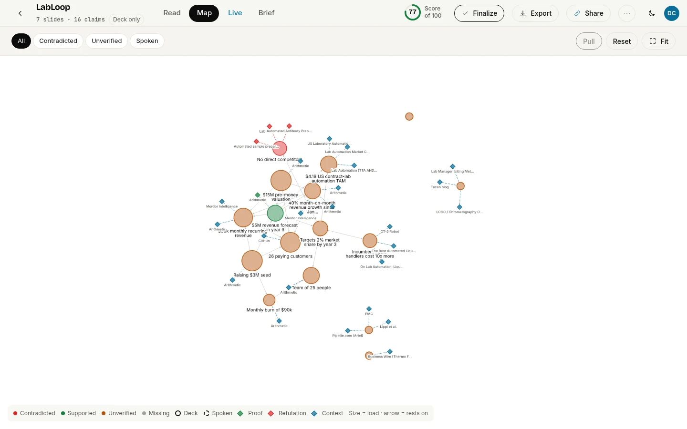
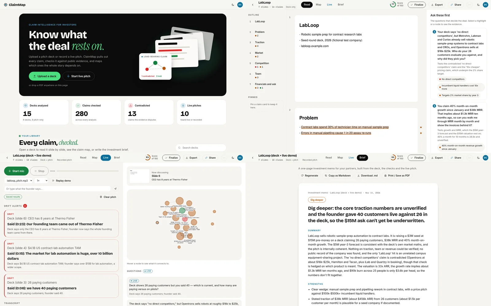
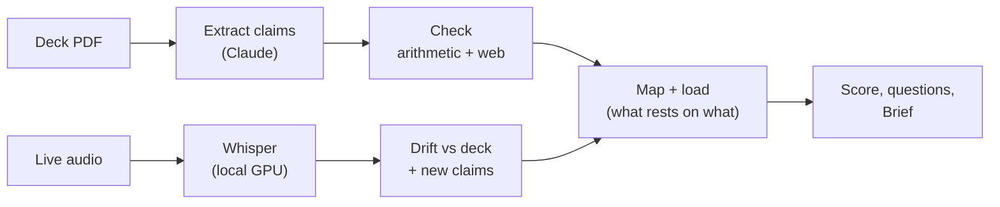

<h1 align="center">ClaimMap</h1>

<p align="center"><b>Know what a startup deal rests on, before and during the pitch.</b></p>

<p align="center">
  <a href="https://github.com/nurasik14/claimmap/stargazers"></a>
  <a href="https://github.com/nurasik14/claimmap/commits/main"></a>
  <br>
  <a href="https://www.python.org"></a>
  <a href="https://fastapi.tiangolo.com"></a>
  <a href="https://www.anthropic.com"></a>
  <a href="https://github.com/SYSTRAN/faster-whisper"></a>
  <a href="#tested-setup"></a>
  <a href="#tested-setup"></a>
</p>

<p align="center">
  <a href="#built-at-a-hackathon">Hackathon</a> ·
  <a href="#features">Features</a> ·
  <a href="#how-it-works">How it works</a> ·
  <a href="#quick-start">Quick start</a> ·
  <a href="#does-it-work">Does it work?</a> ·
  <a href="docs/AI_USAGE.md">AI usage</a>
</p>

A pitch deck makes dozens of claims (customers, growth, market size, "no competitors"), but a deal
usually rests on three or four of them. ClaimMap pulls every claim out of a deck, checks the deck's
arithmetic, searches the web for evidence that supports or refutes each checkable claim, and draws
the claims as a map of what depends on what. During the live pitch it listens, and when the founder
says something different from their own deck, it flags it within seconds and writes the question to
ask. Each deck or pitch ends with a one-page investment memo and a 0-100 score grounded in published
research.

<p align="center">
  
</p>
<p align="center"><sub>Map of LabLoop, a fictional sample deck we wrote with planted problems. Red = contradicted, green = supported, amber = unverified; diamonds are the evidence.</sub></p>

## Built at a hackathon

ClaimMap was built in one day for an investor-judged hackathon on **14 November 2026**, by
Nurassyl Serikov (CS, City University of Hong Kong). The judges were investors, so the product's
buyer was sitting on the panel.

| | |
| --- | --- |
| Research and idea selection | ~10:00 to 11:00: competitors for two candidate ideas, then feasibility spikes (speech-to-text speed, LLM latency) |
| Build | ~11:00 to 13:55, in four versions (v1 to v4), each checked in a real browser before the next |
| Demo | 14:00, to the judges |
| Total | about 4 hours from first research to demo |
| AI coding agents | 9 Claude Code agents, about 90 minutes of agent time in total, each owning a fixed set of files under a written contract |

The process (decisions, scope changes, design reviews) is logged in
[docs/DECISIONS.md](docs/DECISIONS.md) and [docs/JOURNAL.md](docs/JOURNAL.md), and how AI was used is
declared in full in [docs/AI_USAGE.md](docs/AI_USAGE.md).

## Contents

- [Features](#features)
- [Tour](#tour)
- [How it works](#how-it-works)
- [The ClaimMap Score](#the-claimmap-score)
- [Quick start](#quick-start)
- [Tested setup](#tested-setup)
- [Does it work?](#does-it-work)
- [Project structure](#project-structure)
- [Limitations](#limitations)

## Features

- **Claim extraction.** Every claim in a deck (market, traction, growth, competition, team,
  financials, the ask), with its slide and an outline of where it sits on the slide.
- **Checks with sources.** The deck's own arithmetic is checked in plain code; each checkable claim
  is searched on the web for proof and refutation. A verdict only counts if its source URL came back
  from the search, and every contradiction quotes the sentence it rests on.
- **The map.** Claims drawn as a living, Obsidian-style graph: size = how much of the deal rests on
  the claim, colour = verdict, diamonds = evidence. Hover a claim to light up what it connects to.
- **The pull test.** Pull a claim out and watch what falls with it ("6 of 16 claims fall, including
  the ask").
- **Live pitch.** Speech-to-text runs locally on the laptop's GPU. ClaimMap compares what the founder
  says with the deck and with their own earlier words, flags drift about 4 seconds later, adds new
  spoken claims to the map, and updates the score live.
- **Automatic checks.** Every uploaded deck and every finished live session is fact-checked and
  scored without pressing anything.
- **The Brief.** A one-page investment memo: recommendation, red flags linked to claims, what changed
  during the pitch, questions, documents to request. Copy, download as Markdown, or print to PDF.
- **Three modes.** Deck only, pitch only, or deck + pitch. Tags show how a pitch was captured (live
  microphone, recording, typed).
- **Library.** Search, filter by mode, share links, download data, delete; light and dark themes.

## Tour

<p align="center">
  
</p>

- **Library** (top left): every deck and pitch with its score, mode and outcome.
- **Read** (top right): the slides with each claim highlighted, and "ask these first" questions.
- **Live** (bottom left): drift alerts ("Deck: 26 paying customers / Said: we have 40 paying
  customers"), the transcript, a mini-map and live questions.
- **Brief** (bottom right): the memo an investor would send to their partners.

Screenshots use the bundled demo data: LabLoop is fictional, the other decks and pitches are public.

## How it works



1. **Extract.** Claude reads the deck text and returns structured claims (category, value, quote,
   what each claim depends on). Slides are rendered to images and each claim is matched to its words.
2. **Check.** Plain-code arithmetic checks (growth vs revenue, burn vs team, share vs market), then up
   to 12 web searches (6 at a time) for proof and refutation (Claude with the web search tool).
3. **Load.** Each claim gets a load score: how much of the deal rests on it through the dependency graph.
4. **Live.** Browser microphone audio streams over a WebSocket to faster-whisper on the GPU. Each new
   sentence is compared with the deck and earlier speech; drift and new claims stream back as events.
5. **Finish.** Questions, the score and the Brief are written from the checked claims.

| Mode | Input | What you get |
| --- | --- | --- |
| Deck only | PDF | Claims, checks, map, score, Brief |
| Pitch only | Microphone, recording or typed transcript | Spoken claims, self-contradictions, map, score, Brief |
| Deck + pitch | PDF, then the live pitch | Everything above plus drift between deck and pitch |

## The ClaimMap Score

A 0-100 score in four parts, with weights fixed before looking at any outcome:

| Part | Points | What it measures |
| --- | --- | --- |
| Evidence balance | 40 | Supported vs contradicted claims (contradictions count double) |
| Specificity | 20 | Claims concrete enough to check |
| Consistency | 20 | No drift between deck and pitch, or within the pitch |
| Verifiable core | 20 | Whether the 5 claims the deal rests on most are backed |

Each part is grounded in published research, such as the survey of 885 VCs by Gompers et al.
(2020), with quotes in [docs/SCORE_RATIONALE.md](docs/SCORE_RATIONALE.md). In the app, the score
lists the claims that moved it, with points gained or lost. It does not judge the team, the product
or the valuation, and it does not predict outcomes.

## Quick start

Requirements: Python 3.14, [uv](https://docs.astral.sh/uv/), and for live mode an NVIDIA GPU (CPU
works, a few seconds slower).

```bash
git clone https://github.com/nurasik14/claimmap.git
cd claimmap
uv sync
cp .env.example .env            # add your ANTHROPIC_API_KEY
bash scripts/reset_demo.sh      # load the demo library (sample + real decks and pitches)
uv run uvicorn claimmap.app:app --port 8020
```

Open http://localhost:8020. Without an API key, the saved demo results still open, and new analyses
fall back to the `claude` CLI (no web checks). See [.env.example](.env.example) for all settings.

Try it:

1. Open **LabLoop**, then the **Map** tab. Hover "26 paying customers", press **P**: six claims fall.
2. Open **LabLoop (deck + live demo)**, **Live** tab, **Replay demo** with sound on: the founder says
   40 customers, the deck says 26.
3. Upload your own deck with **Upload a deck** (about a minute with web checks).

## Tested setup

| | |
| --- | --- |
| OS | Fedora Linux 44, Hyprland (Wayland) |
| Hardware | Intel i5-12500H (16 threads), NVIDIA RTX 4050 Laptop GPU (6 GB), 15 GB RAM |
| Python | 3.14.8 with uv |
| Key packages | FastAPI 0.162.7, anthropic 2.8.0, faster-whisper 1.2.1, uvicorn 0.54.0 |
| Browser | Chromium (Playwright) at 1920x1080 and 1280x720, light and dark themes |
| Tests | `uv run pytest -q`: 76 passed, 2 skipped (the skipped ones call the real LLM; enable with `CLAIMMAP_LIVE_LLM=1`) |

| Likely to differ elsewhere | Why | Where to change |
| --- | --- | --- |
| GPU speech-to-text | Needs CUDA; falls back to CPU int8 | `claimmap/live/asr.py`, `CLAIMMAP_WHISPER_MODEL` |
| Model names | Set for the models available at build time | `CLAIMMAP_API_MODEL_FAST/SMART` in `.env` |
| Claude access from mainland China / Hong Kong | Needed a VPN | network, not code |
| Microphone | Browser permission, 16 kHz mono capture | `static/js/mic.js` |

## Does it work?

Everything below was run, not estimated.

| Check | Result |
| --- | --- |
| Speech-to-text speed (RTX 4050, small.en) | 23 s of speech in 0.35-0.69 s |
| Live drift alert after the sentence ends | median 4.1 s, max 5.7 s (demo pitch) |
| Deck analysis, 7-slide deck | 19-29 s; 60-90 s with full web checks on a real deck |
| Sample deck with planted problems | caught both planted spoken contradictions (26 vs 40 customers, $4.1B vs $10B) and "no direct competitors" (Metrohm and other vendors, with sources) |
| Real data | 3 founder-published decks and 8 TechCrunch Startup Battlefield final pitches processed end to end |
| Our own deck | ClaimMap contradicted our own competition slide by finding live fact-checking tools we had missed; we fixed the slide |
| Does the score predict Battlefield winners? | No: the 2 winners did not score higher than the 6 finalists. It measures whether claims hold up, not who wins |

Not measured yet: claim-extraction and fact-check accuracy against human analysts, and cost per deck.

## Project structure

```
claimmap/
  app.py              FastAPI routes, WebSocket for live sessions
  schemas.py          shared data model (claims, checks, score, Brief)
  deck/               extraction, arithmetic, Wayback and web checks, slides, questions
  live/               speech-to-text, drift detection, live session
  score.py            the ClaimMap Score and its drivers
  brief.py            the investment memo
  finalize.py         the automatic check after a live session
static/               frontend (vanilla JS modules, Cytoscape.js + d3-force, no build step)
data/demo_snapshot/   saved demo analyses and slide images (restored by reset_demo.sh)
data/demo_audio/      the sample pitch audio (text-to-speech)
scripts/              demo reset, real-data runs, re-checks, scoring
spikes/               feasibility measurements done before the build
tests/                pytest suite and the LabLoop fixtures
docs/                 decisions, journal, pitch, score rationale, AI usage
```

## Limitations

- Built in one day; 76 tests and browser checks, but no line-by-line human code review yet.
- The live drift detector sometimes flags rewording or a misheard name as a contradiction.
- Web checks find context more often than proof for private numbers (customers, revenue), so many
  claims stay "unverified". That is deliberate: nothing turns green without an independent source.
- No user accounts: the "Demo Capital" user is a placeholder, and data is stored as local JSON files.
- No licence has been chosen yet.

## Credits

Fonts: Bricolage Grotesque, Inter, Instrument Serif, JetBrains Mono (SIL Open Font License, via
Fontsource). Graph: Cytoscape.js and d3-force. Speech-to-text: faster-whisper. Real pitches:
TechCrunch Startup Battlefield finals (public videos); real decks: published by their founders.
